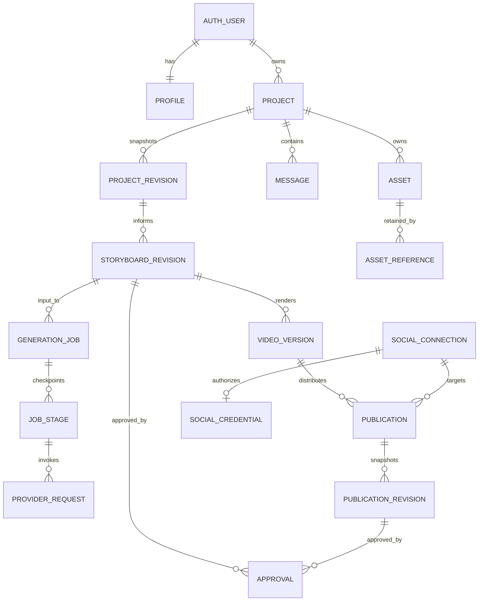

# Explainova — Database and Media Data Design

**Version:** 1.0 · **Date:** November 6, 2026  
**Status:** Proposed logical/physical design; no migrations applied  
**Related:** [API design](API_DESIGN.md), [system design](SYSTEM_DESIGN.md), [PRD](PRD.md)

## 1. Storage responsibilities

- **Supabase Auth:** identities, password/session management. Application records reference `auth.users(id)`; no duplicated password store.
- **Supabase Postgres:** ownership, structured relationships, revisions, approvals, job checkpoints, schedules, connection metadata, and audit.
- **Private Cloudflare R2:** media bytes. Postgres stores asset metadata and object keys, not MP4/audio blobs or permanent signed URLs.
- **Redis/BullMQ:** transient dispatch and worker coordination. Durable job/publication truth remains in Postgres so queue loss is recoverable.
- **Managed secrets/encryption:** platform keys outside application rows; social credentials encrypted in a restricted schema/table or secret store.

Use `public` for RLS-protected application tables and a non-exposed `private` schema for credentials, OAuth attempts, outbox, provider internals, idempotency records, and worker control. Schema placement does not replace explicit privileges.

## 2. Common conventions and invariants

- UUID primary keys, `timestamptz` dates, bigint sizes, integer duration/frame fields, JSONB for schema-validated structured documents.
- `created_at`, `updated_at` on mutable tables. Immutable revisions/approvals have creation timestamps and do not need fake update timestamps.
- Every user-owned record has `owner_id`; project-owned children also have `project_id`.
- Parent tables expose unique `(owner_id, id)` or `(owner_id, project_id, id)` keys so foreign keys enforce owner and project agreement.
- Client IDs never determine ownership. Set identity from the verified session or trusted parent transaction.
- Unique, checked text status columns are initially preferable to database enums for evolving workflows; application validators share the allowed lists.
- Business state transitions are enforced in transactional functions/service operations, not by status CHECK alone.
- Every destructive workflow first prevents new access/work, then performs reference-safe asynchronous cleanup.

### Distinct revision concepts

`projects.edit_version` is the optimistic concurrency counter exposed as API `revision`. Each successful authoring save increments it and creates a matching `project_revisions.revision` snapshot. A storyboard is immutable and has its own UUID and content hash; editing creates another row. Provider input snapshots and ready video versions are also immutable.

Independent mutable resources (preferences, publications, connections, jobs) have `version` for compare-and-swap updates. These are not interchangeable with project edit versions.

## 3. Entity relationships



The ER diagram omits operational/catalog tables for readability. Owner/project agreement applies to all arrows, not just explicit user relationships.

## 4. Identity, projects, and creative records

### profiles

`owner_id uuid PK/FK auth.users`, `preferences jsonb`, `version int default 1`, `deletion_status text`, `created_at`, `updated_at`.

Preferences contain supported defaults: voice selection, theme, captions, logo asset reference. Logo assets may use a dedicated settings project so all assets remain project-owned. Snapshot defaults into a new project; later preference edits do not alter approved versions. Resolve asset references through explicit links, not unchecked IDs hidden in JSON.

### projects

`id`, `owner_id`, `title varchar(140)`, `edit_version int`, `current_storyboard_id uuid nullable`, `current_ready_video_id uuid nullable`, `deleted_at`, timestamps.

Constraints: nonblank title; edit_version ≥1; unique `(owner_id,id)`. Pointers must reference rows from the same owner/project. Add circular pointer foreign keys after child tables exist; use deferrable constraints only for transactions that actually need them.

### project_revisions

`id`, `owner_id`, `project_id`, `revision int`, `brief text`, `reference_text text`, `target_duration_ms int`, `audience_level`, `tone`, `settings jsonb`, `content_hash`, `created_at`.

Unique `(owner_id,project_id,revision)` and `(owner_id,project_id,id)`; target preset in 30000/60000/90000; body limits enforced in application and sensible database length checks. Rows are immutable. Metadata-only title changes still advance the edit counter and snapshot current creative settings for predictable autosave semantics.

### conversations

One row per message: `id`, owner/project, `sequence bigint`, `role` in user/assistant, `text`, `planning_job_id nullable`, `created_at`. Unique `(owner_id,project_id,sequence)`; sequence assigned under a brief project lock. No privileged system instructions, API secrets, or provider raw responses are returned as conversation messages.

### storyboard_revisions

`id`, owner/project, `input_project_revision_id`, `base_storyboard_id nullable`, `schema_version`, `content jsonb`, `content_hash`, `voice_selection_snapshot jsonb`, `theme_snapshot jsonb`, `warnings jsonb`, `source_references jsonb`, `created_at`.

Content includes ordered stable scene IDs, narration, visual parameters, and phrase cues; validate component-specific schemas before insert. CHECK at least JSON array/object types; application schema validation handles richer semantics. Once inserted, content/hash cannot change. A revision may be a candidate result without becoming current if the user edited the project during planning.

Store exact voice/model/settings/component versions in snapshots, not just a catalog foreign key that can later change meaning. Sources are claims/reference metadata, not presumed factual certification.

## 5. Approvals and publication snapshots

### approvals

`id`, `owner_id`, `project_id`, `scope` in storyboard/publication, `storyboard_id nullable`, `publication_revision_id nullable`, `content_hash`, `actor_id`, `created_at`.

Use two explicit nullable foreign keys plus a CHECK requiring exactly the target matching the scope. Avoid an unconstrained polymorphic `target_type,target_id` pair. Actor must equal owner in V1. Target scope/owner/project/hash must match at approval transaction time. Approval rows are immutable audit evidence, not a mutable approved boolean on creative content.

Publication approvals bind ready video, actual destination identity, metadata, schedule, and applicable audience/disclosure choices through an immutable publication revision. Updating any of these creates another snapshot and approval.

### publication_revisions

`id`, owner/project, `publication_id`, `revision int`, `video_version_id`, `connection_id`, `external_account_id_snapshot`, `provider`, `metadata jsonb`, `execute_at timestamptz`, `time_zone text`, `local_datetime text nullable`, `schedule_mode`, `content_hash`, `created_at`.

Unique `(owner_id,publication_id,revision)`; same-owner/project video FK and same-owner connection FK. Validate IANA timezone and local/UTC agreement in service code. A stored timestamp is the instant; timezone is display/audit context. No mutable provider credentials inside snapshot JSON.

Circular publication/current-revision/approval links are resolved with explicitly deferred constraints or an ordered insert of parent, revision, approval, then pointer update in one transaction. No half-approved publication is dispatchable.

## 6. Jobs, checkpoints, and provider calls

### generation_jobs

Unified job table used by API `/jobs` for all asynchronous creative work:

`id`, owner/project, `kind` planning/storyboard/video/voice_sample, `project_revision_id nullable`, `storyboard_id nullable`, `approval_id nullable`, `input_snapshot jsonb`, `input_hash`, `status`, `stage`, `version`, `attempt`, `progress_percent nullable`, `lease_token uuid nullable`, `lease_expires_at nullable`, `heartbeat_at nullable`, `cancel_requested_at nullable`, `result jsonb`, `error_code nullable`, `safe_error_message nullable`, timestamps.

Video jobs require a storyboard and matching storyboard approval. Other job kinds require their corresponding validated input snapshot. CHECK progress 0–100 when present, nonnegative attempts; bound error text size. Status list is identical to API_DESIGN.md. Do not persist transient URLs as durable input dependencies.

Proposed partial unique index: one job per owner where kind=video and status is queued/running/waiting_retry/cancel_requested. A needs_action job releases admission but cannot resume if another active video job exists. Retry acquires admission atomically.

### job_stages

`id`, owner/project/job, `stage_key`, `attempt`, `input_hash`, `status`, `lease_token`, `output_metadata jsonb`, `started_at`, `completed_at`, `error_code`, `created_at`.

Unique `(job_id,stage_key,attempt)`. Artifact references are separate FK-backed links. Cache lookup uses owner + stage input hash + provider/configuration + component/adapter versions. A checkpoint is reusable only if artifact integrity and lifecycle still permit it. Old worker completion must match the current job lease token.

### provider_requests (private)

`id`, owner/project/job/stage, `provider`, `model_id`, `request_fingerprint`, `provider_request_id nullable`, `status` pending/accepted/unknown/completed/failed, `usage_metadata jsonb`, `safe_error_code`, timestamps.

Store minimal usage for internal cost/reliability, not billing. A timeout can leave unknown acceptance and possible consumption; record this instead of treating every retry as free. Do not impose a uniqueness rule that accidentally prevents intentional new attempts. Never store raw authorization headers, keys, or full private response bodies here.

## 7. Assets, media references, and video versions

### assets

`id`, owner/project, `kind` upload/audio/image/thumbnail/video/captions/composition, `r2_key unique`, `content_type`, `size_bytes bigint`, `checksum_sha256`, `state`, `upload_expires_at nullable`, `validated_at nullable`, `deletion_requested_at nullable`, `provenance jsonb`, `license_metadata jsonb`, timestamps.

CHECK size ≥0 and allowed lifecycle: pending/uploaded/validated/active/deletion_pending/deleted/failed. Metadata does not claim bytes exist until validation. Normalize checksums as lowercase 64-character hex. Filenames are display metadata; keys are server-generated.

### asset_references

`id`, owner/project/asset, exactly one of `storyboard_id`, `job_stage_id`, `video_version_id`, `publication_revision_id`, plus `purpose` and `created_at`.

Use `num_nonnulls(...) = 1` and typed same-owner/project FKs. Distinct per-target partial unique indexes prevent duplicate references; nullable columns in a broad unique constraint alone would not do this reliably. Reference rows protect assets from cleanup. Deleting a reference does not itself delete bytes.

### video_versions

`id`, owner/project, `storyboard_id`, `generation_job_id`, `composition_asset_id`, `mp4_asset_id nullable`, `srt_asset_id nullable`, `preview_asset_id nullable`, `state`, `duration_ms`, `width`, `height`, `fps`, `composition_hash`, `renderer_image_version`, `qa_report jsonb`, `created_at`.

Technical checks: output 1080 × 1920, 30 fps, runtime 30000–90000 for ready versions. Ready state requires active verified assets and passing blocking QA; a CHECK cannot query other tables, so finalize with transactional validation. Core rendering inputs and artifacts are immutable once ready. Lifecycle deletion fields may change under controlled operations.

Preserve prior ready versions while a new version builds. A project pointer changes only after the new version passes QA; do not use project updated_at to decide which scheduled version should publish.

## 8. Social accounts and publication state

### social_connections

`id`, `owner_id`, `provider`, `external_account_id`, `display_name`, `status`, `version`, `granted_scopes text[]`, `token_expires_at nullable`, `disconnected_at nullable`, timestamps.

Statuses: active/needs_reconnection/disconnected/pending_deletion. A partial unique `(owner_id,provider)` where disconnected_at IS NULL enforces one reserved connection per provider; `(provider,external_account_id)` with the same predicate prevents external-account sharing. Revoked connections remain reserved until deliberately disconnected, avoiding accidental account takeover through reconnection.

### social_credentials (private)

`connection_id PK`, `owner_id`, `ciphertext`, `encrypted_data_key`, `key_version`, `version`, `rotated_at`, timestamps. Ciphertext contains access/refresh tokens as required by provider. Keep it out of public views, Realtime, ordinary client grants, and queue payloads. Restrict encryption/decryption to connection/publishing services.

Serialize refresh with a lease/version claim, perform network refresh outside a long DB lock, then compare-and-swap the rotated result. Do not persist expired refresh tokens over a newer successful refresh.

### oauth_attempts (private)

`id`, owner, provider, hashed state, encrypted PKCE verifier if needed, allowlisted return path, pending encrypted tokens/candidate metadata when applicable, `expires_at`, `consumed_at`, `status`, created time. Unique state hash, one-use state validation; consume/finalize transactionally. Never put OAuth tokens in browser query strings or durable audit logs. Cleanup expired attempts and pending token material.

### publications

`id`, owner/project, `connection_id`, `provider`, `current_revision_id`, `current_approval_id`, `version`, `status`, `execute_at`, `lease_token`, `lease_expires_at`, `upload_session_reference nullable`, `platform_post_id nullable`, `published_url nullable`, `published_at nullable`, `next_reconcile_at nullable`, `last_error_code`, timestamps.

Status list matches API_DESIGN.md. Current approval must target current revision. `execute_at` is a dispatch projection of the approved snapshot, not independently editable. Upload sessions may be sensitive capabilities: encrypt/restrict them, do not expose them in ordinary API payloads.

Unique confirmed `(provider,external_account_id_snapshot,platform_post_id)` belongs on a publication-attempt/result table or an equivalent constrained result projection; the connection ID alone is insufficient if a user reconnects. Proposed `publication_attempts`: owner/publication/revision, attempt number, external account snapshot, platform/session IDs, outcome, started/completed times. Preserve every attempt rather than overwrite uncertainty evidence.

No database constraint alone guarantees exactly-once external posting. Reconcile unknown outcomes before retry. Both destinations have separate publication records.

## 9. Operational tables

| Table | Key fields / purpose |
| --- | --- |
| private.idempotency_records | owner, operation, key, request hash, resource ID, response status/body, expires_at; unique owner/operation/key |
| private.outbox_events | aggregate type/ID, event type, payload IDs, available_at, lease, attempt, dispatched_at; no tokens |
| private.worker_leases | resource key, fencing token, expiry/heartbeat; only if not embedded in jobs/publications |
| notifications | owner, category, safe payload, related object IDs, read_at, created_at |
| private.audit_events | actor/owner, action, typed object metadata, outcome, correlation ID, safe details, created_at |
| private.voice_catalog | provider voice ID, presentation, name, account scope, models, free-access evidence/status, verified_at, catalog version |
| private.runtime_config | versioned provider model IDs, admission limits, component/renderer versions; references secret names, not secret values |

Do not expose an append-only audit feed to every user just because its rows have owner IDs. Provide purpose-built notifications or safe support views.

## 10. Illustrative constraints and RLS

The following is design guidance, not a complete runnable migration. Referenced tables/columns and grants must be created in migration order.

```sql
-- Parent identity keys used by child owner/project foreign keys.
ALTER TABLE public.projects
  ADD CONSTRAINT projects_owner_id_id_key UNIQUE (owner_id, id);

ALTER TABLE public.storyboard_revisions
  ADD CONSTRAINT storyboards_owner_project_id_key
  UNIQUE (owner_id, project_id, id);

ALTER TABLE public.generation_jobs
  ADD CONSTRAINT jobs_storyboard_owner_project_fk
  FOREIGN KEY (owner_id, project_id, storyboard_id)
  REFERENCES public.storyboard_revisions(owner_id, project_id, id);

CREATE UNIQUE INDEX one_active_video_job_per_owner
ON public.generation_jobs(owner_id)
WHERE kind = 'video'
  AND status IN ('queued','running','waiting_retry','cancel_requested');

ALTER TABLE public.projects ENABLE ROW LEVEL SECURITY;
CREATE POLICY projects_owner_read ON public.projects
FOR SELECT TO authenticated
USING (owner_id = (SELECT auth.uid()) AND deleted_at IS NULL);
```

Use read policies on owned records and narrow, transactional RPC/service operations for mutations. Do not grant clients unrestricted INSERT/UPDATE on approvals, jobs, version readiness, connections, or publication status. Clients should not be able to forge Approved or Published by bypassing the HTTP API.

For authoring writes, a vetted invoker transaction can enforce ownership plus CAS and create snapshots. If a privileged SECURITY DEFINER function is needed, restrict EXECUTE grants, fix its search_path, schema-qualify object names, validate auth identity/ownership explicitly, and never accept arbitrary SQL or arbitrary owner IDs.

Service-role workers bypass RLS. Composite foreign keys, immutable input records, explicit checks, and narrow service credentials are additional protections. RLS does not secure external R2 URLs; media capability issuance is a separate authorization boundary.

## 11. Required indexes

| Access pattern | Index |
| --- | --- |
| Private project library | `(owner_id, updated_at DESC, id DESC) WHERE deleted_at IS NULL` |
| Revision history | Unique `(owner_id, project_id, revision)` |
| Conversation pagination | Unique `(owner_id, project_id, sequence)` |
| Job polling/history | PK ID plus `(owner_id, project_id, created_at DESC, id DESC)` |
| Expired running leases | `(lease_expires_at, id) WHERE status='running'` |
| Stage cache lookup | `(owner_id, input_hash, stage_key, completed_at DESC)` for successful reusable stages |
| Asset cleanup | `(state, updated_at, id)` and indexes on every typed reference FK |
| Video library | `(owner_id, project_id, created_at DESC, id DESC)` |
| Publication calendar | `(owner_id, execute_at, id)` |
| Due dispatch | `(execute_at, id) WHERE status IN ('scheduled','queued')` |
| Uncertain post recovery | `(next_reconcile_at, id) WHERE status='unknown_reconciling'` |
| Outbox dispatch | `(available_at, id) WHERE dispatched_at IS NULL` |
| Notification inbox | `(owner_id, created_at DESC, id DESC)`; optional unread partial index |
| Expiring idempotency/OAuth | `expires_at` cleanup indexes |

Index foreign keys used in deletes/joins. Do not add blanket JSONB GIN indexes to every composition; optimize measured queries. Initial title search is owner-scoped SQL; add trigram/full-text indexes only when needed.

## 12. Critical transactions and race handling

### Autosave

Begin transaction; resolve/reserve idempotency key; lock owned undeleted project; compare edit_version; insert immutable project snapshot; update title/current pointers/version; store response; commit. On any failure roll back all effects. Provider calls do not occur inside this transaction.

### Planning result

Store job result and immutable storyboard under the original owner/project/revision. If the current project edit version differs from the expected planning base, leave it as a candidate. Applying it is another CAS authoring operation.

### Approve and enqueue video

Validate exact owned approval target/hash and all asset references. Acquire user admission (unique active-job constraint plus row lock where needed), create job and outbox event with idempotency response, commit. Outbox dispatch may repeat safely. No provider call before commit.

### Claim, heartbeat, and finalize stage

Claim one eligible row via `FOR UPDATE SKIP LOCKED`, assign new UUID fencing token and lease expiry, then commit. Heartbeats/commits require matching token and eligible status. On expiry, reconciler can requeue with a new token; late old-worker results cannot change authoritative state.

### Finalize ready video

Verify active asset checksums, technical QA, current lease, and undeleted project. Insert final references and set version ready in one transaction. Update current-ready pointer only if appropriate for the requested revision; a late older job must not overwrite a newer accepted result. Notify via committed event. R2 upload occurred outside the transaction.

### Create or change publication

Lock owned publication/connection as applicable; verify ready video and rights/permission gates; insert immutable publication revision and typed approval; attach asset references; update version/status/projection; write outbox; commit. Dispatch revalidates current revision and connection identity.

### Publication dispatch and cancellation race

Lease dispatchable rows atomically. Cancellation sets a request state; publisher checks before the provider call and at safe boundaries. Once an external request may have succeeded, cancellation cannot simply set cancelled without reconciliation. Store external evidence first.

## 13. R2 lifecycle, retention, and deletion

Object keys are private and immutable per artifact version. Asset completion verifies actual object attributes; declared content type/size is not enough. Signed PUT/GET URLs are ephemeral and never stored as canonical references.

Proposed cleanup matches the system design: unreferenced temporary artifacts after 24 hours; retain successful referenced versions until explicit deletion; protect pending-publication assets; primary-store deletion cleanup within seven days after confirmation. Policies remain founder-review defaults.

Use a deletion claim under lock before object removal. All new reference creation must require `state='active'` and serialize against deletion, so cleanup cannot delete a file just attached to a schedule. After object deletion, finalize tombstone; retry failed deletion idempotently. Object-store versioning/backups need their own retention configuration.

Project deletion tombstones first, blocks worker finalization, cancels pending work safely, and releases references only after job/publication reconciliation. Published external posts remain outside local deletion semantics. Account deletion must orchestrate cleanup before deleting `auth.users`; do not apply a giant cascade that destroys scheduling or audit evidence while external operations remain in flight.

## 14. Migration, backups, and operational validation

Proposed migration order:

1. Identity/profile and projects; unique parent keys and initial policies.
2. Project revisions, messages, storyboard revisions, catalogs.
3. Assets, jobs, stage/provider records, video versions; deferred circular pointers after tables exist.
4. Connections/private credentials and OAuth attempts.
5. Publications, publication revisions, typed approvals, attempts, asset reference targets.
6. Outbox, idempotency, notifications/audit; transactional functions and grants.
7. Indexes, RLS isolation tests, cleanup/reconciliation functions, staging restore.

Resolve circular references by creating tables first and adding FKs afterward; define transaction deferrability deliberately. Use additive migrations and backfills; do not rewrite all queued composition JSON during a release. Pin schema versions so older jobs can finish on compatible workers.

Back up Postgres under the selected Supabase plan and test restoration. Pilot recovery goals remain proposed RPO ≤24 hours, RTO ≤8 hours; confirm that the chosen plan/configuration meets them. R2 durability alone is not an independent backup. Store manifests/checksums and define any required media replication/backup before public launch.

Validation must prove: cross-owner FKs fail; client roles cannot forge approvals/jobs/publication states; autosave conflicts preserve both drafts; idempotent commands do not duplicate work; expired worker fencing tokens cannot commit; queue rebuild works; deleted assets cannot gain new references; revoked connections cannot publish; and restored records reconcile with actual objects/platform states.

No SQL schema in this document has been applied to Supabase. Implement and review executable migrations as a separate task before deployment.
