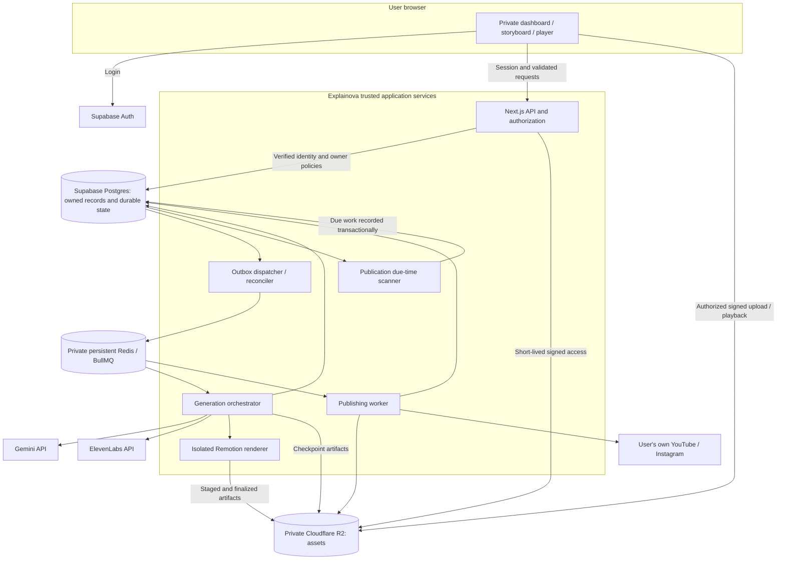
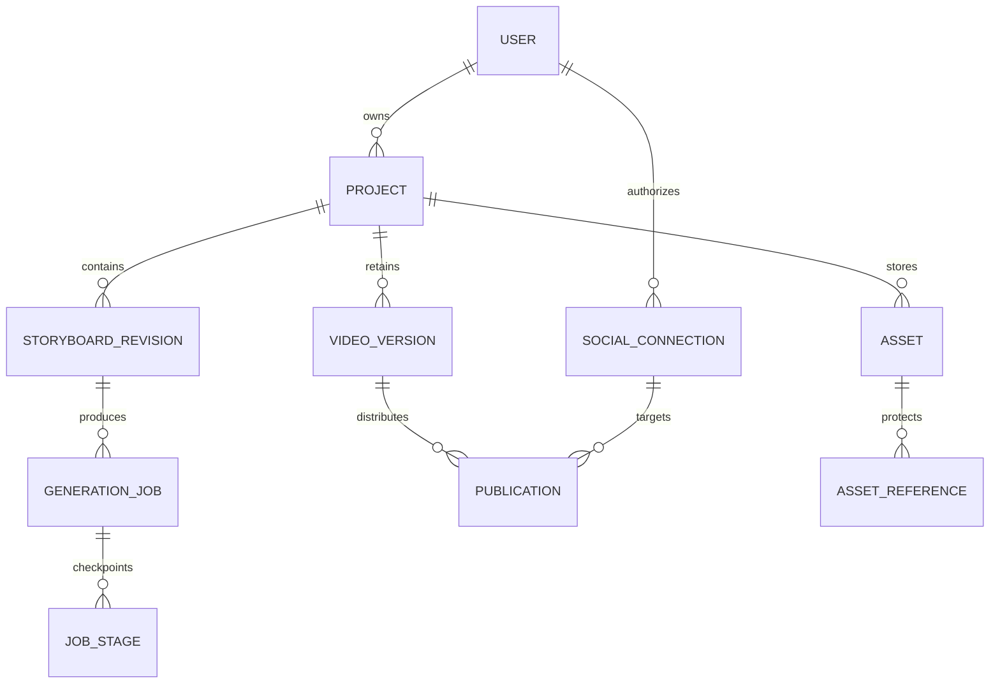
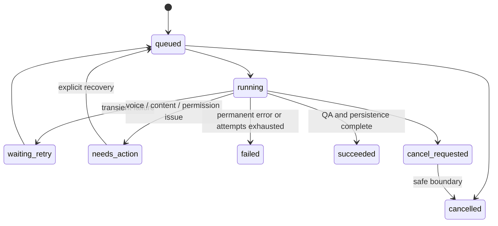

# Explainova — Full Application System Design

**Version:** 1.0  
**Date:** November 6, 2026  
**Status:** Proposed full-app design for review; not a claim of production implementation  
**Related documents:** [PRD](PRD.md), [prototype technical design](TECHNICAL_DESIGN_AND_PROTOTYPE_PLAN.md), [local setup](README.md)

Detailed implementation contracts: [API design](API_DESIGN.md) and [database design](DB_DESIGN.md). These refine abbreviated endpoint/table descriptions in this document; all remain proposed until implemented and reviewed.

## 1. Purpose and decisions

Explainova turns an educational idea into a reviewed storyboard and a captioned, narrated animated explainer. The full application provides private dashboards, durable background generation, downloadable outputs, and publishing to each user's own YouTube and Instagram accounts.

This document describes the engineering system behind that product. It does not authorize cloud provisioning, paid services, or external publishing. The founder has approved the prototype results for further design; production implementation remains a subsequent task.

### Confirmed product constraints

- English, 30–90 seconds, vertical 1080 × 1920 output; initial targets 30/60/90 seconds.
- Plan → Storyboard → Video, with the script embedded in storyboard review.
- Male/Female voice selection and available named voices with previews.
- ElevenLabs selections limited to voices usable through free-tier API access, unless the founder changes this requirement. Never silently select a restricted voice or upgrade a plan.
- Captions remain; decorative bottom pills/tabs and segmented progress bars are absent by default.
- Theme and palette should match the topic. Saved branding can override defaults explicitly.
- Each user owns their dashboard, projects, assets, jobs, settings, schedules, and social connections. No shared publishing account.
- Supabase Auth/Postgres for identity and application records; Cloudflare R2 for media.
- Children-directed content, billing, analytics for revenue, team workspaces, and videos over 90 seconds are outside V1.

### Proposed engineering defaults

| Decision | Proposal | Reason |
| --- | --- | --- |
| Application structure | Modular monolith plus separate workers | Simple deployment without rendering inside web requests |
| Web/API | Next.js, React, TypeScript | Shared schemas and server-side integration boundary |
| AI access | Platform-managed server credentials | No requirement for customers to configure provider keys in V1 |
| Planning | Gemini provider adapter | Validated structured storyboards; configurable supported model |
| Narration | ElevenLabs adapter | Prototype proven with account-accessible premade Alice voice |
| Video | Remotion, versioned React/SVG components | Reproducible preview and render; no arbitrary AI code execution |
| Queue | BullMQ + persistent Redis-compatible backend | Bounded dispatch, retry, and concurrency |
| Durable truth | Postgres job/stage records | Queue can be rebuilt and jobs reconciled after loss |
| Publication schedule | Postgres due-time scanner and short-horizon queue dispatch | Do not rely on months-long Redis delays alone |
| Progress | Authenticated polling initially | Realtime/SSE can be added without changing job contracts |
| Hosting candidate | Cloud Run web/API + always-on VM workers | Separate request lifecycle from rendering/queue consumption |

Hosting region, budget, capacity, retention, and operational targets below are proposals, not founder-approved commitments.

## 2. Prototype evidence and gaps

Two API-based samples rendered successfully at approximately 52–53 seconds, 1080 × 1920 H.264/AAC. Gemini Flash-Lite supplied storyboards, reviewed before narration; ElevenLabs Alice produced audio and character timestamps. Remotion rendered water-cycle and audio-themed diagrams. Exported files passed full decode checks and selected frames were visually inspected.

These tests establish a viable production path, not general automatic animation for any topic. Important gaps:

- The two subjects have authored visual components. A supported scene vocabulary and parameterized visual library must replace one-off topic code.
- Current animation is scene-driven. The full app needs phrase anchors, validated semantic cues, and narration-based timing.
- Local files, Windows defaults, temporary local server, and process memory are unsuitable for production persistence and ownership.
- Authentication, R2 integration, durable queue/outbox, social publishing, multi-tab conflict resolution, and hosted recovery remain unimplemented.
- Provider model availability changes: one older model rejected new users and another returned overload errors. Model configuration must be versioned and observable.
- Account-listed voice metadata is not a guarantee of API synthesis entitlement. The prototype successfully tested Alice; other voices need their own access validation.

## 3. Architecture and trust boundaries



All ownership decisions originate from verified sessions or trusted job records. Queue payloads contain IDs and correlation metadata, not credentials or complete private prompts. Browser access to R2 uses scoped temporary capabilities, not bucket credentials.

The shared AI provider account is an internal service integration. It never implies shared YouTube/Instagram credentials or shared user content. Raw customer content and artifact caches are tenant-scoped.

## 4. Service responsibilities

### Web and API

- Authenticate requests, enforce ownership, validate inputs and concurrency limits.
- Manage projects, autosave versions, storyboard approval, generation requests, and publication approval.
- Issue signed asset access, upload intents, and server-derived destination metadata.
- Return progress and errors without exposing provider keys or tokens.
- Remain responsive while rendering executes elsewhere.

### Generation orchestrator

- Claim jobs by lease, load immutable inputs, and verify ownership relationships.
- Run planning, samples, audio, alignment, asset assembly, cue binding, QA, and render dispatch.
- Persist outputs after each stage; invalidate dependencies after input changes.
- Classify errors into retryable, action-required, or permanent.

### Renderer

- Accept only validated composition schemas and approved component versions.
- Download only authorized internal asset references to a temporary sandbox.
- Run pinned Remotion/Chromium/FFmpeg binaries and approved fonts in a container.
- Enforce CPU, memory, time, and filesystem limits; disable arbitrary external asset requests.
- Produce MP4, preview frames, caption files, technical metadata, and checksums.

### Scheduler, publishing, and reconciliation

- Scan durable due schedules, atomically claim them, and dispatch publication work.
- Validate exact approved video, metadata, account, authorization, and audience/disclosure choices.
- Persist upload sessions/platform IDs and reconcile asynchronous platform processing.
- Handle revoked access and uncertain results without blindly reuploading.

These are logical modules. Initial orchestrator/publisher/scanner can share a worker deployment, but rendering runs in a separate process/container with independent resource limits.

## 5. End-to-end generation workflow

```mermaid
sequenceDiagram
  actor Creator
  participant UI as Web app
  participant API as API
  participant DB as Postgres
  participant Worker as Worker
  participant Providers as Gemini / ElevenLabs
  participant Renderer as Renderer
  participant Storage as R2

  Creator->>UI: Idea, duration, voice, optional references
  UI->>API: Save draft with expected revision
  API->>DB: Save revision and outbox event in transaction
  Worker->>DB: Claim planning job after queue dispatch
  Worker->>Providers: Generate structured storyboard
  Worker->>DB: Validate and save storyboard / warnings
  API-->>UI: Scene previews, narration, voice sample
  Creator->>UI: Review and approve storyboard
  UI->>API: Generate exact revision + idempotency key
  API->>DB: Persist approval, job, and outbox event
  Worker->>DB: Claim generation with lease
  Worker->>Providers: Narration with approved voice
  Providers-->>Worker: Audio and alignment
  Worker->>Storage: Save audio / stage artifacts
  Worker->>Worker: Bind motion cues and captions; validate duration
  Worker->>Renderer: Validated immutable composition
  Renderer->>Storage: Staged MP4 and preview artifacts
  Worker->>DB: QA result and ready immutable version
  UI->>API: Poll owned job status
  API-->>UI: Ready video + authorized playback link
```

Planning and preview work are jobs too; they do not hold a browser request open for an entire provider call chain. Proposed UI polling: every 2 seconds for active work, backing off to 10 seconds for long waits and stopping when the tab is hidden or work finishes.

### Stage inputs and outputs

| Stage | Durable input | Output/checkpoint | Retry rule |
| --- | --- | --- | --- |
| Planning | Brief revision, references, settings | Validated storyboard + claim warnings | Bounded schema repair / transient retry |
| Preview | Storyboard and supported scene components | Rendered scene stills and voice sample | Retry missing artifact only |
| Narration | Approved text, exact voice/model/settings | Audio and provider request metadata | Reuse cache; ambiguous provider acceptance requires caution |
| Alignment | Actual audio, approved text | Word/phrase timings and mismatch report | Local validation; no guessed success |
| Visual assembly | Scene specification + owned assets | Validated component parameters | Unsupported visual returns explicit revision request |
| Cue binding | Phrase anchors + timings | Frame-accurate motion instructions | Reject missing anchors or out-of-range cues |
| Captions | Approved narration + timing | Caption JSON and SRT | Preserve punctuation; check order and bounds |
| Render | Immutable composition + component version | MP4 and stills | Retry from persisted inputs in fresh sandbox |
| QA/finalize | Artifacts and metadata | Ready video version | Never replace last success on failure |

### Duration and narration

Estimate word budget during planning; measure actual narration before final timing. Keep output within 30–90 seconds. Proposed target tolerance is ±10% around the chosen duration, clipped to the allowed overall range; show actual runtime. This tolerance needs founder approval.

If the script cannot fit, propose a shorter/longer version for approval. Never truncate speech or silently rewrite approved wording. Small provider-supported speech-rate changes must be constrained and previewed. Any audio regeneration invalidates dependent alignment, captions, and timing.

## 6. Reusable animation and theme system

### Supported visual vocabulary

Start with labeled-object diagrams, process/flow, comparison, sequence, keyword explanation, and simple charts. Topic packs such as water cycle and sound waves are reusable assets/components inside this vocabulary, not hardcoded per-user scripts.

Each scene includes a learning purpose, approved narration, entities, labels, relationships, a supported component type, and motion cues. AI chooses allowed elements and parameters. It cannot submit executable JSX/JavaScript, arbitrary remote URLs, or unbounded SVG markup.

If a requested visual cannot be represented accurately, offer a simpler supported diagram, identify the limitation, or ask for an uploaded asset. Do not disguise generic imagery as a precise visualization.

### Theme contract

```typescript
type Theme = {
  id: string;
  version: number;
  background: string;
  foreground: string;
  accent: string;
  secondary: string;
  fontId: string;
  illustrationStyle: 'flat' | 'technical';
  showDecorativeTabs: false;
};

type MotionCue = {
  objectId: string;
  action: 'reveal' | 'highlight' | 'move' | 'count' | 'draw-path';
  phraseAnchor: string;
  occurrence: number;
  startFrame: number;
  durationFrames: number;
};
```

Suggest a curated theme by topic (for example, water/earth blues or audio-studio violet/cyan), validate contrast, and snapshot it per revision. Brand preferences can be applied deliberately. Caption safe areas and essential diagram text must remain readable independently of decorative palette choices.

Generate storyboard stills and final frames from the same component schema. Lock schema, theme, asset, font, and renderer versions for reproducibility. A phrase anchor must identify a specific occurrence, since words can repeat.

### Voice catalog and licensing

Maintain Male/Female presentation filters backed by real provider IDs. Store account-access evidence, supported models, last verification time, and availability state. Do not interpret voice gender metadata as a statement about a real person's identity.

Only select ElevenLabs voices usable through free-tier API access. Website visibility or a library listing is insufficient. A restricted response invalidates that selection and asks for another; never silently change voices. Voice previews and successful audio are cached by owner, text hash, exact voice/model/settings, and adapter version.

Voice availability is separate from output rights. The prototype's free-plan audio is for noncommercial testing. Before a public commercial SaaS or monetized publishing, verify provider terms and obtain the appropriate output license; use free-accessible voices under an eligible license if permitted. This is a launch dependency, not a V1 customer-billing feature.

## 7. Data model

Every user-owned table includes `owner_id`, creation/update times, and suitable ownership policies. IDs are UUIDs. Immutable revisions use unique monotonically numbered project revisions plus content hashes.

| Table | Main fields and constraints |
| --- | --- |
| profiles | user ID, defaults, deletion state |
| projects | owner ID, title, current revision, current ready version, deleted_at |
| project_revisions | owner/project IDs, revision, brief, settings, references; unique project/revision |
| conversations | owner/project IDs, message ordering, role, text; paginated |
| storyboard_revisions | owner/project IDs, input revision, scene JSONB, schema version, source/warnings, voice/theme snapshot |
| approvals | owner, object type/ID, content hash, scope, approval time; immutable audit record |
| assets | owner/project IDs, R2 key, media type, size, checksum, provenance, license metadata, lifecycle state |
| asset_references | asset ID + owner, referencing revision/video/publication; supports safe cleanup |
| generation_jobs | owner/project/revision IDs, status, stage, input hash, idempotency key, lease token/expiry, attempt |
| job_stages | job/stage IDs, artifact references, input hash, request ID, outcome, timestamps |
| provider_requests | owner/job/stage, provider/model, request fingerprint/ID, accepted/unknown/completed state; no secrets |
| video_versions | owner/project IDs, approved storyboard ID, composition/version hashes, duration, QA state, MP4/SRT assets |
| social_connections | owner, provider, external account ID, encrypted token reference, scopes, expiry/status |
| publications | owner, connection, video version, approved metadata/hash, timezone, execute_at UTC, status, upload session/platform ID |
| outbox_events | aggregate ID, event type, payload IDs, attempts, available_at, dispatched_at |
| notifications | owner, event, related object, read time |
| audit_events | actor, action, owned object, outcome, correlation ID; redacted |

### Relationships



Composite owner/project foreign keys or equivalent database constraints prevent cross-owner references even when a service key bypasses policies. API and workers recheck matching ownership before external actions.

### Indexes and transactional operations

- Index `(owner_id, updated_at DESC, id)` for project pagination; title search initially scoped Postgres search, not a separate search service.
- Index `(status, execute_at)` for due publications, `(status, lease_expires_at)` for recovery, and undispatched outbox availability.
- Unique `(owner_id, operation, idempotency_key)` with input-hash comparison; reuse with a different body returns conflict.
- Unique active `(provider, external_account_id)` connection prevents sharing the same external account across users. Reconnection/transfer is deliberate and verified.
- Use transactions for revision+autosave updates, approval+job+outbox creation, schedule claims, and version readiness.
- Claim due work using row locks/`SKIP LOCKED` and lease fields. Never call a provider inside a long database transaction.

## 8. Authentication, authorization, and autosave

Use Supabase Auth with verified server sessions. Login identity and social OAuth connections are separate. Check issuer, audience, expiration, and verified user identity through the supported Supabase server flow; do not trust client-supplied user IDs or decoded-but-unverified tokens.

Enable owner-based RLS on all user-accessible tables. Service-role credentials bypass RLS and must remain server-side; privileged paths require explicit authorization. [Supabase RLS documentation](https://supabase.com/docs/guides/database/postgres/row-level-security)

Mutations use same-origin/CSRF protection, secure session cookies where applicable, input limits, and rate limits. User-provided references are data, not instructions granting tool access.

### Autosave flow

1. Create a server-owned draft immediately.
2. Debounce edits approximately 800 ms; send `expected_revision` and an idempotent save operation ID.
3. Atomically compare revision and save; acknowledge the new revision before showing Saved.
4. On conflict return HTTP 409 and offer reload, preserve local draft, or explicit merge/reapply.
5. On connection loss show Not saved and keep a pending local draft where supported. Do not persist credentials with drafts.
6. On reconnect reconcile server state before replay; do not overwrite a newer tab silently.

Editing during generation creates another draft revision. Running jobs and scheduled posts stay bound to their original approved inputs.

## 9. Media storage and lifecycle

Proposed private key format: `users/{ownerId}/projects/{projectId}/versions/{versionId}/{assetId}.{ext}`. Prefixes organize data; the backend's authorization grants access.

The browser requests an upload intent, receives a generated key and short-lived signed PUT, uploads, then calls completion. Validate size, detected content type, checksum where available, and ownership before activating the asset. Use raster uploads initially; reject active content and unexpected formats. A PUT capability alone does not enforce every file validation rule.

Use signed GETs for playback/downloads after ownership checks. Presigned URLs are bearer capabilities, can leak until expiry, and use R2's S3 API domain rather than custom domains. Proposed expiry is 10 minutes for uploads and 15 minutes for playback, refreshed on reauthorization. [R2 presigned URL documentation](https://developers.cloudflare.com/r2/api/s3/presigned-urls/)

Do not claim that signing makes a link user-bound or instantly revocable. For immediate revocation, use an authenticated streaming proxy or remove access to the object; standard direct links can remain usable until expiry. Public buckets are not required.

### Object/database consistency

Objects transition `pending → uploaded → validated → active → deletion_pending → deleted`. Render into new immutable object keys. Finalize version references only after QA and successful persistence. Reconcile orphaned objects and missing references because R2 and Postgres have no shared transaction.

Proposed retention for initial review:

- Temporary/unreferenced uploads and failed render files: clean after 24 hours.
- Previous successful versions: retain until explicit deletion or an agreed future storage policy.
- Scheduled assets: protected by references until publication/cancellation resolves.
- Deleted projects: hide and revoke new access immediately; asynchronous primary-storage cleanup within 7 days, subject to backup lifecycle.
- External posts: project deletion does not delete already published posts.

These are proposed policies; set budgets and lifecycle rules before a public pilot. Do not enable a blanket R2 expiry rule that removes referenced scheduled assets.

## 10. Durable jobs, recovery, and concurrency



### Outbox and queue semantics

Persist a job and its outbox event in one Postgres transaction. The dispatcher adds the queue job with a deterministic ID, then marks delivery. If it crashes after enqueue, replay is harmless. Treat queue delivery as at-least-once; handlers must be idempotent.

Workers claim a lease with a fencing token. Heartbeat approximately every 15 seconds with a proposed 90-second lease. Stage commits must match the current lease token so an old worker cannot overwrite a reclaimed job. Queue deduplication does not replace database concurrency control.

Reconciliation scans undispatched events, expired leases, abandoned renders, missing artifacts, and uncertain publications. It recreates missing queue work from Postgres. Redis durability is helpful; the queue is not the sole source of truth.

### Retry and provider side effects

- Proposed transient retry schedule: 10 seconds, 30 seconds, then 2 minutes with jitter; respect provider retry guidance and operator limits.
- Do not retry authentication errors, restricted voices, unsupported input, or invalid content as transient failures.
- A provider timeout after request acceptance may already consume quota. Record request fingerprints/IDs, recover completed results if supported, and cap ambiguous retries. Do not promise exactly-once AI consumption.
- Never change provider/model/voice without recording the change. Changes affecting narration or meaning require renewed approval where applicable.
- Rendering can restart from durable inputs; successful narration is reused. Scene-level cache reuse does not imply partial MP4 encoding resumes.

### Initial limits to benchmark

One active generation per user, two concurrent renders across the pilot worker fleet, and bounded planning/TTS concurrency per provider account. Admit work transactionally to avoid racing limits. Apply fair scheduling so one user cannot exhaust all queued work. An administrator can pause a provider or disable admission without losing drafts.

## 11. Publishing and scheduling

Each user connects one YouTube channel and one eligible Instagram account in V1. OAuth state is one-use, short-lived, bound to the authenticated user; use PKCE where supported. Encrypt tokens using a managed key service, separate from logs and ordinary project access. Request minimum necessary scopes.

### Approval and dispatch

1. Creator approves an immutable ready video, destination connection, metadata, audience/disclosure choices, and publish time.
2. Store approval hash and metadata snapshot. A later edit does not silently change that post.
3. Store time as UTC plus the IANA timezone and original local selection. Resolve DST ambiguities explicitly.
4. Scanner checks due rows every proposed 30 seconds and transactionally leases eligible work.
5. Publisher verifies all owners, connection identity, approval hash, and assets before the external call.
6. Use platform-native scheduled publishing when its semantics fit; otherwise dispatch near the due time. Internal schedule records remain authoritative and are reconciled with platform state.
7. Persist upload session/IDs immediately and poll processing as required. Show Published only after confirmation.

### Failures and limits

Track each destination separately. YouTube success plus Instagram failure must not reupload to YouTube. When external success is uncertain, enter `unknown_reconciling`; recover from upload sessions/provider IDs where possible. If confirmation is impossible, request user action rather than duplicate blindly.

Proposed late-publication policy: automatically continue within a five-minute lateness window; beyond it, require Publish now or Reschedule. Make the actual platform publish time visible. This policy requires founder approval and is not a hard delivery-time guarantee.

Disconnecting an account suspends pending work and removes usable authorization. Reconnecting a different channel/account requires review of pending destinations. Cancelling a schedule after upload has started is best effort; reconcile rather than claim an external post was cancelled.

Instagram may require a fetchable media URL. Issue a scoped temporary asset capability with sufficient lifetime for platform ingestion and verify the current integration contract. Do not expose the whole bucket. Account eligibility, app permissions/reviews, upload quotas, and native scheduling support are pre-launch integration gates. Download fallback remains available but does not satisfy a completed publishing integration.

## 12. API contracts

Version internal APIs under `/api/v1`. Use cursor pagination for libraries and notifications. All object lookups are owner-scoped. Return safe errors as `{code, message, retryable, correlationId, details}`; exclude raw credentials/provider bodies.

| Method and resource | Contract |
| --- | --- |
| POST `/projects` | Create owned draft |
| GET `/projects?cursor=...` | User's paginated library |
| GET/PATCH/DELETE `/projects/:id` | Read, optimistic save, soft-delete |
| POST `/projects/:id/planning-jobs` | Enqueue brainstorming/storyboard revision |
| PATCH `/storyboards/:id` | Save revised scene data with expected revision |
| POST `/storyboards/:id/approve` | Record approved content hash |
| POST `/generation-jobs` | Exact approved revision and idempotency key; return 202 |
| GET `/jobs/:id` | Stage, percentage where measurable, warnings, recovery actions |
| POST `/jobs/:id/cancel` | Best-effort cancellation request |
| GET `/voices` | Account-supported catalog; Male/Female filters |
| POST `/voice-samples` | Cached, quota-controlled preview job |
| POST `/assets/upload-intents` | Owned, constrained temporary upload capability |
| POST `/assets/:id/complete` | Validate and activate uploaded object |
| GET `/assets/:id/access` | Temporary authorized playback/download |
| GET `/projects/:id/video-versions` | Immutable versions and QA states |
| GET `/connections/:provider/start` | Begin owned OAuth flow |
| GET `/connections/:provider/callback` | Validate OAuth and finalize connection |
| DELETE `/connections/:id` | Disconnect and suspend affected schedules |
| POST `/publications` | Approved version/destination/metadata/time |
| PATCH `/publications/:id` | Explicit reschedule or cancel, state permitting |
| GET `/publications` | Owned calendar/list and outcomes |

Use 401 for missing/expired session, 403 for forbidden actions, owner-scoped 404 for inaccessible objects, 409 for conflicts, 422 for invalid supported input, and 429 for admission limits. Validate requested state transitions on the server.

## 13. Deployment and infrastructure

### Proposed first hosted pilot

- **Web/API:** containerized Next.js on Cloud Run, HTTPS/custom domain, bounded autoscaling.
- **Workers:** always-on Compute Engine VM running isolated orchestrator/publisher/scanner processes and render containers. Start by benchmarking 4 vCPU/8 GB RAM, two render slots, rather than assume that sizing is sufficient.
- **Queue:** private managed Redis-compatible instance with persistence and compatible BullMQ semantics. Avoid request-only serverless Redis offerings that cannot support worker connection requirements.
- **Database/auth:** managed Supabase project with pooling, migrations, backups, and owner policies.
- **Media:** private Cloudflare R2 bucket(s), server-generated signed URLs, dedicated least-privilege credentials.
- **Secrets:** managed secret store for AI keys and service credentials; encrypted social tokens using managed key encryption.
- **Operations:** container registry, CI/CD, logs/metrics, secret rotation, and infrastructure as code.

Select compatible regions close to the expected audience; India is a working audience assumption, not a residency commitment. Confirm Supabase, compute, and queue availability/latency before choosing region. Document cross-provider data processing and transfer paths.

A single worker VM is a pilot cost/complexity compromise and a failure point. Use automatic recreation plus checkpoint recovery. Before committing to stronger availability, run workers across failure domains and avoid a single queue/scanner instance dependency. Postgres leases let multiple scanners coexist safely.

### Scaling path

Scale render capacity separately from API traffic. Later, render containers may run as Cloud Run Jobs; set explicit execution limits and retain durable checkpoints outside ephemeral containers. Do not implement a never-ending BullMQ consumer inside an ordinary request-driven container and assume it keeps running without requests. [Cloud Run job configuration](https://docs.cloud.google.com/run/docs/create-jobs)

Do not introduce Kubernetes, a separate event-stream platform, vector database, or microservices per feature for V1. Revisit only when measured load or isolation requirements justify them.

### Environments and releases

Separate local, staging, and production Supabase/R2/queue credentials and social test applications. Never copy production tokens into local test artifacts. Pin dependencies, renderer image, browser, fonts, schema/component versions, and provider model configuration.

CI runs tests, type checks, dependency scans, schema validation, and short deterministic render checks. Stage database changes with expand/migrate/contract patterns; roll back application code without breaking jobs pinned to older composition versions. Retain compatible renderer images until old queued/scheduled work resolves.

## 14. Capacity and cost model

These figures are illustrative planning inputs, not forecasts or provider quotes:

- Pilot assumption: 100 registered users, 20 daily creators, two outputs per daily creator = 40 outputs/day.
- At 10 MB per output, final MP4 growth is about 0.4 GB/day or 12 GB/month, excluding revisions, audio, source assets, and backups.
- Add a measured amplification factor for revisions and intermediate artifacts; retaining everything indefinitely is not a free-tier strategy.
- Render throughput estimate: `slots × 60 / mean render minutes`. Two slots and a hypothetical five-minute mean yield 24 renders/hour at full utilization, before overhead. Benchmark actual hardware and leave headroom.
- Track queue age and p95 generation time rather than scale solely by average CPU.

Operating cost = model usage + speech usage + rendering compute + database/auth + queue + object storage/operations + applicable network/service charges. Cache unchanged owner-scoped audio and compositions; cap previews, retries, concurrent jobs, and request size. No customer-facing billing is added in V1.

Shared provider free quotas are project/account-level resources, not an allowance multiplied by the number of Explainova users. Free testing allowances are not a production capacity or commercial-license commitment. Establish an operating budget before public launch.

## 15. Security, privacy, and deletion

- Use TLS, explicit owner checks, RLS, least-privilege server credentials, and scoped temporary media access.
- Platform keys and social tokens never appear in browser bundles, queue payloads, screenshots, logs, or committed `.env` files.
- Encrypt social refresh/access tokens; serialize refresh per connection to avoid race conditions and preserve rotated tokens atomically.
- Log correlation IDs, provider status codes, hashes, and stage outcomes; exclude private script text and signed URL query strings by default.
- Sanitize uploads, cap input size, disable arbitrary generated code, and restrict renderer network access to approved assets.
- Do not fetch arbitrary user URLs in V1. Future URL ingestion must defend against SSRF, redirects, and private-network access.
- Scope caches by owner even when inputs match. Reuse only intentionally public, licensed component/font assets across users.
- Account deletion blocks new activity, cancels pending jobs/schedules safely, disconnects social accounts, removes primary records/media asynchronously, and documents backup expiry. It does not imply removal of externally published posts.
- Rate limits, abuse handling, and factual/content review protect the product's intended educational workflow; automated checks never guarantee truth or platform acceptance.

## 16. Observability, quality, and recovery objectives

### Metrics and alerts

- Generation conversion, end-to-end/stage p50/p95 latency, queue age, render failures/timeouts, retries, and provider quota errors.
- Autosave failures/conflicts, unauthorized access attempts, and expiring credentials.
- Schedule lateness, per-destination success, unknown publication outcomes, and reconnection needs.
- R2 orphan growth, artifact loss, database/queue health, and internal usage per completed video.
- Alert on sustained provider failure, stuck leases, unexpected queue growth, missed schedules, secret-access anomalies, and unavailable workers.

Job IDs propagate through logs, provider request records, assets, and publication attempts. A minimal restricted operator view supports inspect/retry/cancel, provider pause, and reconciliation; it must not reveal raw customer tokens.

### Proposed service targets

- Saved drafts survive ordinary process/VM restarts with no loss of acknowledged writes.
- p95 ordinary API reads/saves below one second excluding provider operations; autosave status acknowledges within two seconds of a debounced request under normal conditions.
- p95 render/generation targets set after hosted benchmarks, not inferred from local samples.
- Due-work claim within 60 seconds under normal operations; final platform publication is externally dependent.
- Pilot disaster recovery targets: database RPO ≤24 hours and RTO ≤8 hours, requiring configured backups and restore drills. More stringent RPO requires an appropriate database backup/PITR plan.
- R2 durability is not a complete backup strategy. Keep database/asset manifests and design a restore procedure; if independent media backup is required, select and cost it before launch.

Targets are acceptance proposals, not a public SLA. Free plans may not satisfy them. Test restoration into staging and reconcile object references before declaring disaster recovery complete.

### Quality gates

Technical QA checks codecs, dimensions, runtime, full decode, missing audio/assets, caption monotonicity/bounds, text overflow, and cue validity. Human review checks accuracy, intelligibility, visual meaning, and whether motion follows narration. Proposed semantic cue tolerance is ±300 ms on a reviewed test set, not a guarantee for every sentence.

## 17. Failure matrix

| Failure | System behavior |
| --- | --- |
| Gemini overload or model retirement | Bounded retry; expose model action; no unrecorded fallback |
| Restricted/unavailable voice | Stop affected stage, preserve prior output, request compatible choice |
| TTS timeout after possible acceptance | Mark uncertain request; recover/cache if possible; bounded explicit retry |
| Voice/text revision | Invalidate dependent audio/timing/captions; create new immutable version |
| Invalid scene schema or phrase anchor | Bounded repair; no arbitrary code or guessed visual success |
| Render crash / worker shutdown | Reclaim fenced lease; rerun from durable stage artifacts |
| Redis loss | Rebuild dispatch from durable jobs/outbox; reconcile leased work |
| R2 unavailable / upload incomplete | Retain job state and retry persistence; do not mark ready prematurely |
| R2 success, database finalize failure | Reconcile staged object; never attach to wrong owner/version |
| Database unavailable | Stop mutations/dispatch safely; show unsaved state |
| Two tabs save concurrently | Return conflict and preserve local changes |
| Signed URL expires | Reauthorize and refresh access; stable stored object key |
| User deletes while rendering | Tombstone, cancel at boundary, prevent late worker readiness commits |
| Social token revoked | Needs reconnection; retain approved asset and metadata |
| Different account reconnected | Suspend old schedules until destination review |
| Platform accepts but response lost | Unknown/reconciling; no blind duplicate upload |
| One destination fails | Retry only failed destination |
| Schedule missed beyond grace | Needs action; no silent much-later posting |
| Content changed after schedule | Old approved version remains scheduled until explicit replacement |

## 18. Implementation path and acceptance

1. **Contracts and migration:** shared schema validation, versioned scene/theme/cue formats, provider adapter interfaces, job state contracts. Preserve current sample outputs as regression fixtures.
2. **Private authoring:** Supabase login, owner policies, projects, autosave conflicts, storyboard editing and approvals, private R2 upload/playback.
3. **Production pipeline:** durable jobs/outbox, voice catalog, reusable scene library, actual phrase alignment, captions, preview/render parity, hosted worker recovery.
4. **Distribution:** OAuth, individually owned connections, metadata approval, schedules, cancellation, reconciliation; validate platform review requirements early.
5. **Pilot hardening:** isolation tests, queue/worker failure injection, backup restore, load tests, operational visibility, licenses/privacy review, founder acceptance.

Release tests must include two users proving no cross-user project/media/social access; unavailable voices; all target durations; caption and semantic motion checks; scene revisions; worker death; duplicate requests; expired links; partial publication; ambiguous external success; and missed schedules. Hosted output must be reviewed, not just structurally valid.

The local prototype's dashboard and in-memory job set are not promoted directly to production. Keep proven rendering/provider components, replace local persistence/admission with the designed services, and migrate no secrets or account tokens through exported test JSON.

## 19. Decisions for founder review

| Question | Proposed default |
| --- | --- |
| First launch audience/location | General adult creators, initial India audience assumption; confirm languages/geographies later |
| Initial operating scale | 100 registered users / 40 outputs per day planning scenario |
| Deployment and monthly budget | GCP compute + Supabase + R2; budget to be agreed before provisioning |
| AI credentials | Platform-managed keys, no customer BYOK interface in V1 |
| Commercial voice rights | Appropriate service license before commercial use; keep free-API-accessible voice selection policy |
| Old successful video retention | Keep until explicit deletion; finalize storage limits before public onboarding |
| Late schedule behavior | Five-minute grace, then user action |
| Target duration tolerance | ±10%, always within 30–90 seconds |
| Initial recovery objectives | RPO ≤24h, RTO ≤8h with paid/appropriate backups as needed |

These do not block the design document. Confirm them before dependent implementation or paid infrastructure decisions. The full-app work starts only when the founder asks to proceed.

## 20. Reference documentation

Technical references checked November 6, 2026. Provider behavior, terms, and entitlements must be rechecked during implementation.

- [Supabase RLS and service-role behavior](https://supabase.com/docs/guides/database/postgres/row-level-security)
- [Cloudflare R2 presigned URLs](https://developers.cloudflare.com/r2/api/s3/presigned-urls/)
- [BullMQ documentation](https://docs.bullmq.io/)
- [Cloud Run Jobs](https://docs.cloud.google.com/run/docs/create-jobs)
- [Remotion licensing](https://www.remotion.dev/docs/license/pricing)
- [ElevenLabs API voice listing](https://elevenlabs.io/docs/api-reference/voices/search)
- [ElevenLabs timestamped speech](https://elevenlabs.io/docs/api-reference/text-to-speech/convert-with-timestamps)
- [ElevenLabs voice-library restrictions](https://elevenlabs.io/docs/eleven-creative/voices/voice-library)
- [ElevenLabs commercial output rights](https://elevenlabs.io/docs/overview/administration/billing)
- [Gemini rate limits](https://ai.google.dev/gemini-api/docs/rate-limits)
- [YouTube upload API](https://developers.google.com/youtube/data/reference/rest/v3/videos/insert)
- [Instagram publishing documentation](https://developers.facebook.com/docs/instagram-platform/instagram-api-with-instagram-login/content-publishing/)
