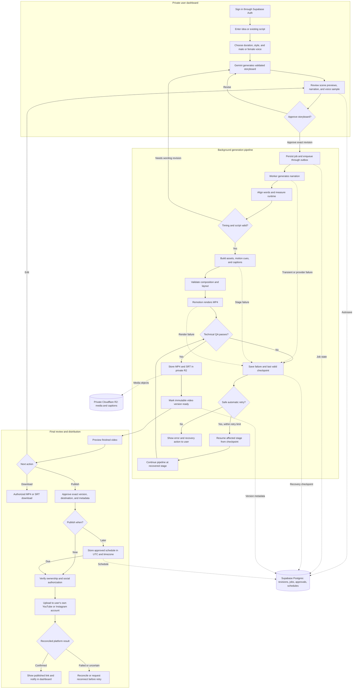

# Explainova — Technical Design, Pipeline, and Prototype Plan

- **Version:** 1.2 — local prototype first; full application gated on review
- **Date:** November 4, 2026
- **Status:** Proposed implementation design; no implementation started
- **Companion specification:** [V1 PRD](PRD.md)

## 1. Scope and approach

Build a desktop-first web application that turns an idea into an approved storyboard and then a 30–90-second vertical educational animation. Use AI to create structured content, and tested animation components to render it. Keep the interface to Plan → Storyboard → Video.

V1 includes English narration with Male/Female voice selection, captions, individual user dashboards, private assets, reliable background generation, and individually authorized YouTube/Instagram publishing. Billing and children-directed content remain excluded. The initial prototype proves video creation and recovery; it is not the complete V1 release.

### Immediate execution scope: local prototype only

The next build is a local single-user pipeline prototype, not the application architecture described below. The founder will test the output before deciding whether to build the full application.

- Provide a minimal local input form or CLI for idea/script, 30/60/90-second target, and Male/Female voice selection.
- Generate a local storyboard JSON plus readable preview, then require approval before rendering.
- Produce narrated animated MP4s and caption files, support one-scene corrections, and retain earlier successful outputs.
- Save inputs, stage checkpoints, audio, captions, and rendered files in local project folders. A local runner is sufficient; no Supabase, R2, Redis, or BullMQ setup is required for this test.
- External AI API calls may still be necessary. Local execution does not mean offline AI; provider keys remain in local server/process configuration and out of source control.
- Exclude dashboard/product polish, authentication, multi-user isolation implementation, cloud deployment/storage, social connections/publishing/scheduling, and billing from this prototype.
- Process jobs while the local runner is active. After shutdown, restart from saved checkpoints; do not promise generation while the computer is off.
- Keep provider and renderer interfaces reusable, but do not build production infrastructure prematurely.

Prototype pipeline:

```text
Local idea/script + duration + voice
  -> AI storyboard -> local review/approval
  -> narration -> alignment -> motion + captions
  -> Remotion render -> quality checks
  -> local MP4 + SRT -> founder review and revisions
```

**Stop gate:** after local tests, present sample outputs and measured limitations. Do not begin the dashboard, hosted infrastructure, or full application until the founder approves proceeding. The architecture and later phases below describe the potential full V1 and are not authorization to implement it now.

## 2. Short technical design

| Layer | Choice | Responsibility |
| --- | --- | --- |
| Web | Next.js / React / TypeScript | Dashboard, planning chat, storyboard editor, player, publishing panels |
| Identity | Supabase Auth | Login, sessions, user identity |
| Database | Supabase Postgres | Owned project records, JSONB scene specifications, revisions, jobs, schedules |
| Media | Private Cloudflare R2 | Audio, images, thumbnails, MP4s, SRT files |
| Planning | Gemini API adapter | Idea refinement and schema-validated storyboard generation |
| Voice | Gemini TTS adapter; compare ElevenLabs | Selected voice, narration, samples |
| Alignment | Provider timestamps or local faster-whisper | Word timings checked against approved script |
| Animation | Remotion + original SVG/React components | Shared preview/render composition and synchronized motion |
| Worker | Separate Node.js process | Durable pipeline execution and rendering |
| Queue | BullMQ with compatible persistent backend | Dispatch, retries, concurrency, delayed work |
| Distribution | YouTube / Meta API adapters | User-authorized uploads and publication reconciliation |

Use one application database and private storage infrastructure with user ownership enforced throughout. No shared social account. Database rows and R2 keys store ownership; key naming alone does not authorize access.

### Service boundaries

- **Browser:** edits and preview; no provider keys or social refresh tokens.
- **Next.js server:** verifies sessions, enforces ownership, validates requests, saves revisions, issues signed media URLs, and dispatches jobs.
- **Worker:** loads approved immutable inputs, performs generation/rendering, persists artifacts/checkpoints, and updates progress.
- **Adapters:** isolate model IDs, voice IDs, authentication, provider errors, and response parsing.
- **Renderer:** accepts validated composition data, not arbitrary AI-generated JavaScript.

For the initial prototype, run a local pipeline process and store persistent state in local files. Supabase/R2 and a durable queue belong to the later full application. A minimal local UI may call the runner without keeping a browser request open throughout rendering. Production requires hosted workers and persistent queue infrastructure.

## 3. Pipeline technical design

### End-to-end pipeline flowchart

Solid arrows show the main workflow; dotted arrows show persistence and recovery. Each job runs against an approved revision. Publishing requires a separate approval of the finished video.



Recovery re-enters the actual failed stage and completes all subsequent stages before QA; the recovery continuation node summarizes this path. It never skips required narration, alignment, composition, or rendering. User-requested edits create a new revision; they do not alter a running job or replace an approved scheduled asset silently.

### Plain-text overview

For Markdown viewers without Mermaid support:

```text
PRIVATE DASHBOARD
  Sign in -> Idea/script -> Duration/style/voice
               -> AI storyboard -> Review -> Approve
                                      ^        |
                                      |        v
BACKGROUND WORKER                      |     Queue job
                                      |        |
  Approved wording changes -----------+     Narration
                                               |
                                       Audio alignment
                                               |
                                   Motion cues + captions
                                               |
                                     Validate -> Render
                                               |
                                       Technical QA
                                               |
                                    Private R2 + Ready version
                                               |
FINAL REVIEW                      Preview finished video
                                  /         |           \
                                Edit     Download     Approve post
                                                          |
                                                   Now / Schedule
                                                          |
                                              Verify owned connection
                                                          |
                                               Own YouTube / Instagram
                                                          |
                                              Reconcile result + Notify

Autosave/checkpoints -> Supabase Postgres
Stage failure -> bounded retry from checkpoint, or visible recovery action
Previous successful video remains available during revisions and failures
```

### Stage contracts

| Stage | Inputs | Persisted output | Failure handling |
| --- | --- | --- | --- |
| Plan | Brief, reference text, target duration, preferences | Validated storyboard revision | Bounded schema repair; otherwise actionable error |
| Preview | Scene specifications, selected voice | Thumbnails and voice sample | Retry affected artifact only |
| Approval | Revision ID | Approval timestamp and immutable input snapshot | Reject stale revision approval |
| Narration | Approved text and exact voice configuration | Audio object and duration | Retry transient errors; unavailable voice requires reselection |
| Alignment | Audio and approved script | Word/phrase timestamps, mismatch report | Check missing words; block unresolved severe mismatch |
| Composition | Scene specs and timestamps | Versioned composition JSON, caption JSON/SRT | Validate cue references, layout, duration |
| Render | Composition and private assets | Temporary MP4 | Resume/retry using valid prior artifacts |
| QA/persist | Rendered MP4 and metadata | Immutable ready version, R2 keys, checksums | Do not replace prior successful version on failure |
| Publish | Approved version, metadata, owned connection | Platform ID and reconciled publication state | Reconcile uncertain external success before retry |

Narration controls final timing. Storyboard timings are estimates. Align cue phrases to actual speech, then map seconds to frames. Timestamps alone do not explain meaning: the storyboard must specify which phrase triggers which visual action.

Proposed cue structure: `sceneId`, `objectId`, `action`, `phraseAnchor`, `startMs`, `durationMs`. Supported actions are predefined (reveal, highlight, move, count, draw-path). Reject missing objects and out-of-range timing. Phrase anchors that cannot be matched require regeneration or review, rather than guessed timing.

## 4. Scene and voice specifications

### Storyboard schema

```typescript
type VoiceConfig = {
  presentation: 'male' | 'female';
  provider: 'gemini' | 'elevenlabs';
  modelId: string;
  voiceId: string;
  rate: number;
};

type SceneSpec = {
  id: string;
  type: 'diagram' | 'process' | 'comparison' | 'sequence' | 'keywords';
  narration: string;
  estimatedDurationMs: number;
  visual: Record<string, unknown>; // validated with a schema per scene type
  cues: Array<{
    objectId: string;
    action: 'reveal' | 'highlight' | 'move' | 'count' | 'draw-path';
    phraseAnchor: string;
  }>;
};
```

Maintain a server-side voice catalog mapping the Male/Female UI options to currently supported voice IDs and sample assets. Persist the exact selection in each revision. Preview both categories; do not silently change providers or voices during retries. If rate adjustment is unsupported by a provider, disable that control or use a tested rendering adjustment rather than assume a generic API parameter exists.

ElevenLabs voice policy: only offer voices confirmed usable through the connected account's free-tier API access. Website/library visibility is not sufficient evidence. Filter restricted voices, handle access-denied responses explicitly, and ask for a compatible replacement rather than silently choosing a paid or inaccessible voice. This requirement persists for future project work unless changed by the founder. API voice availability and output commercial licensing are separate checks.

Start with diagram, process, and keyword components. Add comparison/sequence components for full V1. Use SVG objects with stable IDs so motion acts on individual elements. Generated raster artwork is optional, not required for the prototype.

## 5. Data, APIs, and ownership

### Tables

- `profiles`: user ID and default preferences.
- `projects`: owner ID, title, brief, target duration, current revision, optimistic-lock version.
- `storyboard_revisions`: project/owner IDs, schema version, scene JSONB, voice configuration, approval.
- `assets`: owner/project IDs, R2 key, type, size, hash, lifecycle state.
- `generation_jobs`: owner/project/revision IDs, stage, status, attempt, lease/checkpoint, error code.
- `video_versions`: owner/project IDs, composition snapshot, asset IDs, actual duration, QA status.
- `social_connections`: owner, provider, external account ID, encrypted token reference, status.
- `publications`: owner, connection, immutable video version, approved metadata, UTC execution time, timezone, external ID, state.

Enable owner-scoped row-level security. Privileged server/worker paths explicitly validate ownership even when database policies are bypassed. Enforce consistent ownership across references; authorize every read, edit, job submission, media request, and publication.

### API surface (proposed)

| Endpoint | Purpose |
| --- | --- |
| `POST /api/projects` | Create owned draft |
| `GET/PATCH/DELETE /api/projects/:id` | Read, save with expected revision, delete |
| `POST /api/projects/:id/storyboards` | Queue storyboard generation |
| `POST /api/projects/:id/generations` | Approve revision and queue video job idempotently |
| `GET /api/jobs/:id` | Owned job progress; polling is sufficient initially |
| `GET /api/voices` | Supported voice catalog |
| `POST /api/voice-samples` | Generate/cache sample with validated configuration |
| `POST /api/assets/upload-intent` | Issue owned, constrained upload URL |
| `POST /api/assets/:id/complete` | Validate upload and finalize asset record |
| `GET /api/assets/:id/access` | Authorize and issue temporary read URL |
| `POST /api/publications` | Approve exact version for publish/schedule |
| `PATCH /api/publications/:id` | Cancel/reschedule when allowed |
| `GET /api/connections/:provider/start` | Begin OAuth with state/PKCE as applicable |
| `GET /api/connections/:provider/callback` | Validate callback and store owned connection |

All endpoints require authentication except the narrowly scoped OAuth callback, which must validate the initiating session/state. Do not accept client owner IDs as authority. Use request schemas, upload limits, and a consistent error format: code, message, retryability, job/stage reference where relevant.

## 6. Reliability and revision rules

- Autosave with a short debounce and expected revision number. Return conflict rather than overwrite edits from another tab.
- Database job records are authoritative; queue dispatch uses an outbox/reconciliation mechanism so a database write followed by queue failure does not strand a job.
- Generation idempotency key includes project, approved revision, and operation. Workers checkpoint each stage and tolerate repeated delivery.
- Use bounded backoff, stage timeouts, heartbeat/lease recovery, and explicit terminal states.
- Artifact cache keys include input hash, voice/model configuration, schema/component versions, and settings.
- Narration or voice changes invalidate audio, alignment, captions, and dependent timing. Visual-only edits preserve audio when valid.
- Final assembly may rerender even when only one scene changed. Never promise zero work on unaffected scenes.
- Keep previous successful output until the revision passes QA. A scheduled post remains bound to its approved version.
- R2 and Postgres cannot share a transaction: stage assets, finalize references, reconcile orphaned files, and retry cleanup safely.
- Record progress/error metadata without logging API secrets, tokens, or full private prompts by default.

## 7. Publication workflow

1. Verify all project, video, asset, connection, and publication owners match.
2. Validate final QA, metadata, audience/disclosure choices, and access credentials.
3. For schedules, store UTC plus the user's timezone; reconfirm ambiguous local times.
4. Upload through the user's authorized destination and persist returned IDs immediately.
5. Reconcile processing state; mark published only after confirmation.
6. On unknown success, enter reconciliation state before any retry. Exactly-once external publication cannot be guaranteed solely by queue deduplication.
7. On expired credentials, retain the post and require reconnection. A different account requires destination reapproval.

YouTube and Instagram feasibility must be tested early. API permissions and platform reviews are release dependencies, not assumed capabilities. A download-only prototype is acceptable; a download fallback alone does not satisfy full V1 publishing scope.

## 8. Prototype plan

### P0 — Setup and feasibility

- Create development configuration and server-side provider adapters without committing secrets.
- Confirm Remotion license eligibility, Gemini API availability, and speech commercial rights. Do not provision R2 or Supabase for the local test.
- Compare both voice categories on three identical scripts using Gemini and ElevenLabs where available.
- Defer YouTube/Instagram account connections and integration work until after the local prototype gate.

**Exit:** supported voice catalog, tested API calls, selected initial voice provider, and local output/checkpoint folders.

### P1 — Deterministic video proof

- Build a hand-authored six-scene, 60-second refrigerator or water-cycle explanation.
- Implement diagram/process/keyword components and a preview player.
- Generate narration, align timestamps, animate semantic cues, render captions, and export 1080 × 1920 MP4 plus SRT.

**Exit:** a reviewed video with understandable narration, correct visual relationships, readable captions, and synchronized key actions. Test Male and Female voice outputs.

### P2 — AI storyboard to video

- Generate storyboard JSON from an idea and validate it against supported components.
- Add storyboard scene cards, embedded narration editing, and approval.
- Add schema-repair limits and clear unsupported-scene handling.
- Route approved inputs through the same tested rendering path.

**Exit:** at least three different ideas produce valid previews and complete videos without manual code changes.

### Local prototype acceptance and stop gate

- Test both voice options and 30/60/90-second targets across representative topics.
- Review factual clarity, purposeful motion, caption readability, and audio synchronization.
- Complete one narration/voice revision and one visual revision without losing the previous output.
- Simulate a stage failure and restart from local checkpoints.
- Report render time, machine resource use, provider usage, and unresolved quality limitations.
- Deliver sample MP4/SRT files and local run instructions, then wait for the founder's decision.

P3–P5 below are conditional full-application work. They do not start automatically after P2.

### P3 — Private dashboard and durable generation

- Add two test users, Supabase ownership policies, autosave, private R2 assets, worker queue, progress, and checkpoints.
- Test browser closure, worker restart, provider failure, duplicate clicks, multi-tab conflict, and signed URL expiry.
- Make one narration/voice revision and one visual revision while preserving the previous MP4.

**Exit:** no cross-user access, no lost confirmed saves, no duplicate active job for identical input, and successful checkpoint recovery.

### P4 — Distribution proof

- Connect each test user's own supported social accounts.
- Test approved version uploads, one scheduled post, reconnection, and partial destination failure.
- Simulate an uncertain upload response and verify reconciliation before retry.

**Exit:** successful authorized publishing on supported test accounts or an explicit documented platform blocker. Full V1 release requires resolving remaining integration requirements.

### P5 — Review and V1 backlog

- Expand to ten representative topics and 30/60/90-second targets.
- Measure render time, memory, retries, caption drift, correction rate, and internal service usage.
- Select final models, hosting/queue configuration, safe concurrency, operational targets, and remaining scene inventory.

**Exit:** evidence-based go/no-go for the full V1 build, with remaining PRD work listed. No delivery dates or unlimited-free-operation claims before measurement.

## 9. Validation and deliverables

Required prototype artifacts:

- Three sample MP4s plus SRTs, including both voice options.
- Validated storyboard/composition schema and initial animation components.
- Working local runner/minimal interface, local checkpoint storage, run instructions, and environment-variable template without secrets.
- Local failure/recovery results; two-user isolation testing is deferred to the full application.
- Publishing and account integration requirements listed as deferred, not prototype deliverables.
- Short benchmark report and prioritized V1 implementation backlog.

Human review checks teaching clarity, factual accuracy, and purposeful motion. Automated checks cover runtime, decodability, audio presence, missing assets, invalid cue times, and caption/layout constraints. Target key action synchronization within approximately ±300 ms on the reviewed set; establish production performance goals after measurement.

No accounts will be created, paid services enabled, or external content published merely by approving this design document. Those actions follow the implementation task and available authorization.
