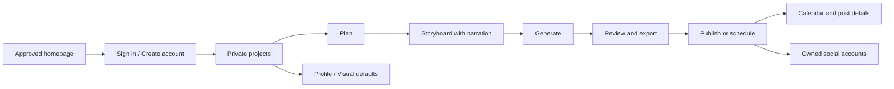

# Explainova — UI Design Screen Map

Date: November 6, 2026

[Open the Stitch project](https://stitch.withgoogle.com/projects/6749329833982008557) · [Local review gallery](design/index.html)

## Scope

20 desktop screens and 10 mobile layouts extend the approved homepages using the existing Kinetic Editorial design system. The two homepages and design-system asset are preserved. New app frames are arranged below the homepage area: core workflow, account/settings, publishing/recovery, then mobile.

These are design mockups with HTML references and previews. Authentication, generation, scheduling, and publishing are not connected application functionality. Desktop password/verification forms and secondary recovery patterns should adapt responsively during implementation; the ten explicit mobile frames cover the main flows.

## Screen inventory

| Screen | Device | Current Stitch screen ID | Local HTML |
| --- | --- | --- | --- |
| Video — Review & export | Desktop | `17341825182550401956` | [HTML](design/stitch/c8fc478a351840a3976e7b6a7b6e139a.html) |
| Create — Generating | Desktop | `14521072765977383558` | [HTML](design/stitch/017e6d72f5c94162a9190c495e536e71.html) |
| Create — Storyboard | Desktop | `11039817686535010347` | [HTML](design/stitch/3318e39d8be2431eb69962113815e897.html) |
| Create — Plan | Desktop | `13154674188565191324` | [HTML](design/stitch/c2d652ff626a44b38d715b744b3f9e35.html) |
| Projects — First project | Desktop | `8765993077125350910` | [HTML](design/stitch/960d851333df4dbf8bcf37bf1d3ea72a.html) |
| Projects — Library | Desktop | `7256798442537298972` | [HTML](design/stitch/cd5f12f420a045d49dc803065de56790.html) |
| Account — Create account | Desktop | `10756599876156838598` | [HTML](design/stitch/07bcacb5c948484f8b0a03dab7748f17.html) |
| Account — Sign in | Desktop | `12641191307512295670` | [HTML](design/stitch/0f35f508f1dc4c33889a2b081706c44a.html) |
| Account — Check your email | Desktop | `10123129177307471611` | [HTML](design/stitch/02d2776c1f6d4ea1bd1510e9c0d583e8.html) |
| Account — Forgot password | Desktop | `18125573506310583109` | [HTML](design/stitch/02eb5f9db98846a18e4bb32a15b61d86.html) |
| Account — Reset password | Desktop | `10372529442079691928` | [HTML](design/stitch/49eafeb16baf49c3aeed480a095ed3bb.html) |
| Settings — Visual defaults | Desktop | `2186643931778014300` | [HTML](design/stitch/a912de73eed748688f9923344eaa3c58.html) |
| Settings — Profile & security | Desktop | `5838000435265170538` | [HTML](design/stitch/57c55757d16e4e548fef533a8ef815d0.html) |
| Connected accounts | Desktop | `16916170540266807709` | [HTML](design/stitch/7d9d0d6cd8c34db59ebf35d25587ea58.html) |
| Publishing — Calendar | Desktop | `7473964014647633865` | [HTML](design/stitch/e4d74d2807c140488598559289b42b53.html) |
| Publishing — Compose | Desktop | `16545165725178492490` | [HTML](design/stitch/9578e298dd17416c98cdb0fd782efaed.html) |
| Publishing — Post details | Desktop | `11685576163561484729` | [HTML](design/stitch/fe4dc286bacf4b96aaf702a11d370e91.html) |
| Generation — Recovery | Desktop | `2440120708789743418` | [HTML](design/stitch/e6d4348c72fa4c62ae9ff2dfe01c27dd.html) |
| Notifications — Activity | Desktop | `14508609485013712308` | [HTML](design/stitch/14bff6aab491437cbf29528e0626ee62.html) |
| Editing — Save conflict | Desktop | `15151395203164747375` | [HTML](design/stitch/5467fc2832d940cea7fa2f99cac0dfac.html) |
| Mobile — Sign in | Mobile | `15895402968006593595` | [HTML](design/stitch/9a6bef09462c4abfb5934ade66e73787.html) |
| Mobile — Projects | Mobile | `1838466528055839219` | [HTML](design/stitch/762ec7d29362439789420edd5bb02862.html) |
| Mobile — Plan | Mobile | `4732748943866484172` | [HTML](design/stitch/8d35dfd6bb164fceb02c7f5eb7edccd4.html) |
| Mobile — Storyboard | Mobile | `14594139494145011842` | [HTML](design/stitch/90bb99022e2a4e3e84893d819e5a3fc1.html) |
| Mobile — Generating | Mobile | `5514870177079305451` | [HTML](design/stitch/b160b51c7ac24bfeb5661d7833d6e274.html) |
| Mobile — Review & export | Mobile | `12639612326013570737` | [HTML](design/stitch/b93c6d12c34e4aeea0150ddb00ee5869.html) |
| Mobile — Publish | Mobile | `5648283686925465558` | [HTML](design/stitch/04d85dcf9f594b1da9a86226ab3923cc.html) |
| Mobile — Publishing agenda | Mobile | `5194108178200366801` | [HTML](design/stitch/0ca34ed52a134d5fa880ef8b1156796a.html) |
| Mobile — Connected accounts | Mobile | `3201636484809643371` | [HTML](design/stitch/6ce1893e07804120a710ec2dc61b0836.html) |
| Mobile — Settings | Mobile | `4453576673139896352` | [HTML](design/stitch/76f57494bd3b461da65957b76a72829c.html) |

## Main user flow

## Design and handoff rules

- Plan → Storyboard → Video is the only authoring stepper; voice is a setting.
- Male/Female options, available voice samples, topic-adaptive themes, captions, previous versions, and explicit final publishing approval.
- 30/60/90-second targets; vertical 1080p/30fps MP4 and SRT.
- No billing, credits, analytics, children-directed modes, shared channels, or decorative tabs inside videos.
- Original homepages are approved references; app screens remain subject to founder review.
- Local text corrections and exact-layout previews were imported using the document/image endpoint used by Google’s Stitch SDK after the MCP edit tool reported changes it did not persist. HTML is included with each imported preview.
- All 30 exported layouts were rendered at their intended 1280px desktop or 390px mobile widths; horizontal overflow checks passed. Representative desktop and mobile screens were visually inspected. This is not a full accessibility or interaction audit.
- Technical, PRD, API, and database contracts take precedence over any remaining illustrative mock data or decorative copy.

## Source files

- `design/stitch-reviewed-screens.json`: current remote IDs, original source IDs, dimensions, and local paths.
- `design/stitch/`: reviewed HTML and PNG exports.
- `design/stitch-canvas-backup.json`: original homepage/design-system layout backup.
- The canvas synchronization preserves original frames and updates only the managed app-screen references; older generated alternatives remain available as resources.
